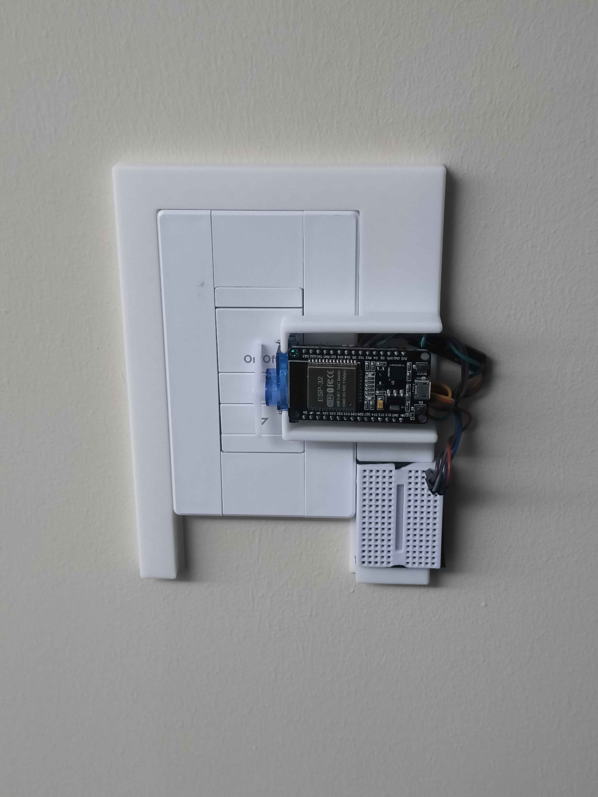
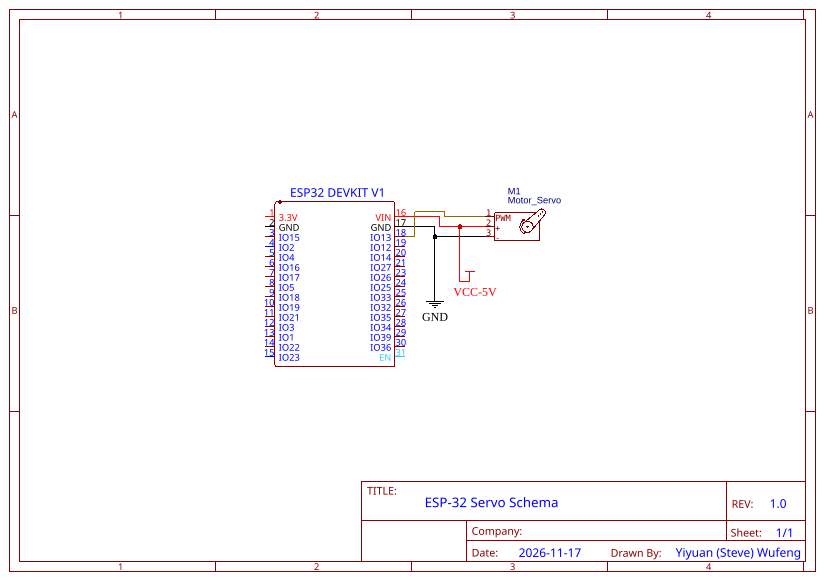
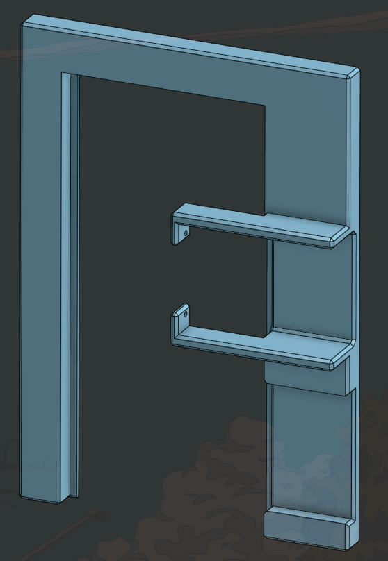

# Servo Light Switch (ESP32)

An ESP32 firmware that drives a servo to physically press a light switch. The board connects to WiFi, advertises itself as `light-switch.local` via mDNS, and exposes a small HTTP API for toggle, reset (double toggle), and dim actions. It also accepts simple commands over the serial console.


## Files

- `servo.ino` — the firmware; see it for wiring, exact angles/timings, motion sequences, serial commands, and HTTP endpoint details.
- `secrets.h.example` — template for WiFi and HTTP credentials.
- `secrets.h` — local credentials; create from the example and never commit it (gitignored).
- `press_loop.sh` — host helper to repeatedly call `/press`.
- `Smart Light Switch Holder.stl` - 3D model for 3D printing. Also available on [OnShape](https://cad.onshape.com/documents/dcb8cd6bc0ec2a60984a044c/w/5e433ff80808044ccef69e6a/e/351e66e5575f2ac30c43b155?renderMode=0&uiState=6afcb1c6ac3ff47a8b1ed0da) if you want to export to another format.

[](https://github.com/SteveWufeng/ESP32-Smart-Light-Switch/blob/main/Smart%20Light%20Switch%20Holder.stl)
*Click the image above to view and rotate the interactive 3D model directly on GitHub.*


## Quick Start

1. Install the servo library:

   ```sh
   arduino-cli lib install ESP32Servo
   ```

2. Create `secrets.h` from `secrets.h.example` and fill in your WiFi SSID/password and desired HTTP username/password.

3. Compile and upload from `motor_control/bin`:

   ```sh
   arduino-cli compile --fqbn esp32:esp32:esp32 servo
   arduino-cli upload --fqbn esp32:esp32:esp32 -p /dev/ttyUSB0 servo
   ```

4. Open a serial monitor at 115200 baud to see the assigned IP and `READY`. If mDNS works on your network, the device is at `http://light-switch.local/`.

## Basic Use

```sh
curl "http://light-switch.local/press"          # toggle the switch once
curl "http://light-switch.local/reset"          # fast double toggle
curl "http://light-switch.local/dim?times=4"    # dim with 4 taps
curl "http://light-switch.local/status"         # current servo state
```

For repeated presses, run `SERVO_HOST=<ip-or-host> SERVO_PASS=<password> ./press_loop.sh` (Ctrl+C to stop).

> **Security:** HTTP Basic Auth is currently stubbed out in the firmware and traffic is plain HTTP — use only on a trusted LAN. See `servo.ino` for the exact behavior and configuration constants.
